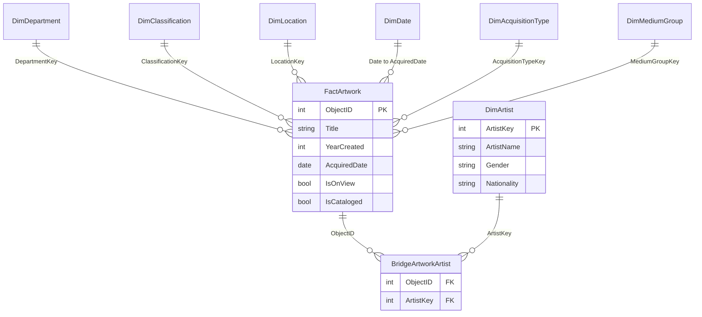
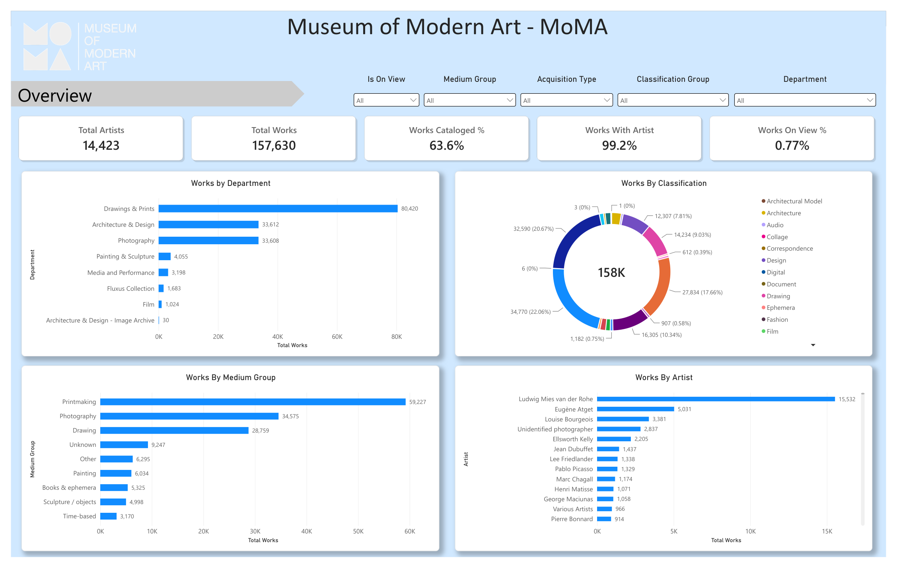
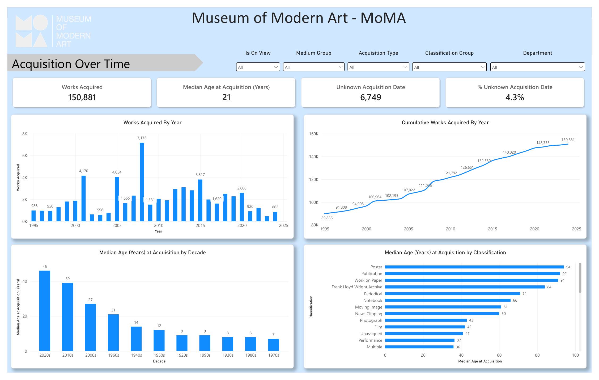
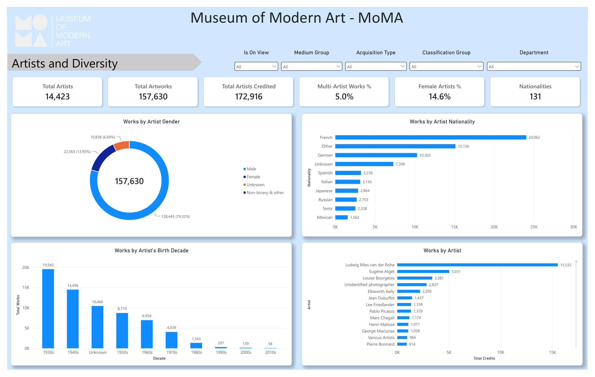
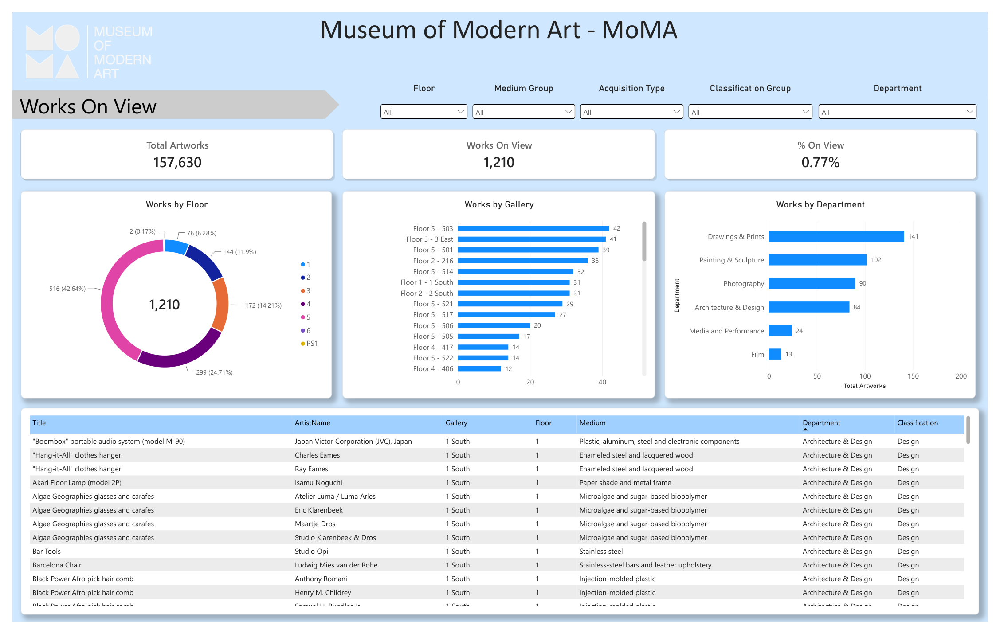
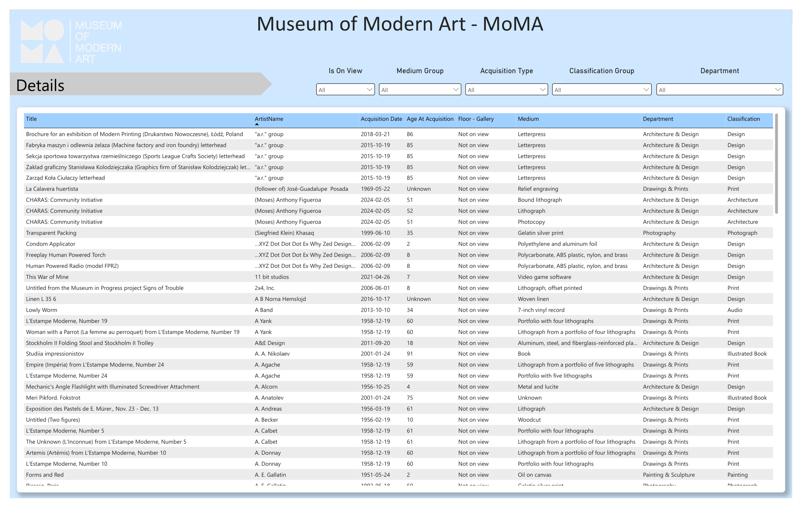

# MoMA collection: Power BI report

A Power BI report on the Museum of Modern Art (MoMA) collection: 157,630 artworks and 15,638 artists. Raw CSVs are cleaned in Python into a star schema, loaded into a Power BI semantic model, and shown on five report pages.

```text
raw_data/*.csv -> notebooks (Python cleaning) -> processed/*.csv -> Power BI model -> 5 report pages
```

| Folder | Contents |
|---|---|
| `raw_data/` | Source files, unchanged |
| `notebooks/` | `01` profiling, `02` cleaning and star schema, `03` to `05` follow-up scripts |
| `processed/` | Cleaned star-schema CSVs (the Power BI input) |
| `Power BI/` | PBIP project: `moma.SemanticModel` and `moma.Report` |
| `docs/` | `eda_findings.md`, `model_validation.md`, screenshots |

## 1. Source

| File | Rows | What it is |
|---|---|---|
| `Artworks.csv` | 157,630 | One row per artwork (30 columns) |
| `Artists.csv` | 15,638 | One row per artist (9 columns) |
| `MoMA_OnView.xlsx` | 1,142 works | Works on view. A strict subset of the CSVs. Used for checks only |
| `MoMA_data_dictionary.csv` | 39 fields | Field descriptions |

- The field set matches MoMA's public collection data. The project does not record where the files were downloaded or their licence, so confirm both before reusing the data.
- Files are UTF-8 with a byte-order mark. Quoted fields can contain line breaks.
- `Artworks.ConstituentID` holds one or more artist IDs, comma-separated.

## 2. Source vs cleansed data

Counts recomputed from the raw files vs the cleaned CSVs and the Power BI model. Full detail is in [docs/model_validation.md](docs/model_validation.md).

| Check | Source | Cleaned / model | Match |
|---|---|---|---|
| Artwork rows | 157,630 | 157,630 | Yes |
| Artist rows | 15,638 | 15,639 | Yes. One added `Unknown / no artist` row (key 0) |
| Artist-work pairs | 172,916 | 172,916 | Yes |
| Artists with at least one work | 14,423 | 14,423 | Yes |
| Departments / classifications | 8 / 39 | 8 / 39 | Yes |
| Works on view | 1,210 | 1,210 | Yes |
| Works with an acquisition date | 150,881 | 150,881 | Yes |
| Distinct acquisition dates | 1,774 | 1,774 | Yes |
| Cataloged works | 100,231 | 100,231 | Yes |
| Works with no artist | 1,269 | 1,269 | Yes |
| Acquired before created | 90 | 90 | Yes |
| Blank gender / nationality | 3,257 / 2,496 | `Unknown` 3,258 / 2,497 | Yes. Includes the key 0 row |

## 3. Transformations

Notebook `02` holds the rules, `03` to `05` add the follow-ups. Run order: `02`, then `03_fill_unknowns.py`, `04_dim_acquisition_type.py`, `05_dim_medium_group.py`.

| Output | Transformations |
|---|---|
| **DimArtist** (15,639) | Artists.csv only. Gender grouped into Male, Female, Non-binary & other, Unknown (7 source spellings). Birth and death year 0 set to null. NationalityGroup keeps the top 15 nationalities, the rest become Other. Adds BirthDecade, LifeStatus, HasWikidata, HasULAN. Blank bio and nationality become `Unknown`. `...Label` text columns show `Unknown` for null years. Adds key 0 `Unknown / no artist` |
| **BridgeArtworkArtist** (172,916) | `ConstituentID` split on commas, blanks dropped, one row per work-artist pair, with ArtistPosition |
| **FactArtwork** (157,630) | One row per `ObjectID`. Drops the positional artist columns, Seat Height, Circumference, ImageURL and the dimensions text. YearCreated is the first 4-digit year in `Date`, with DateQuality (Exact / Range / Approximate / Unknown). AcquiredDate parsed from `DateAcquired` (blank stays null). AgeAtAcquisition is acquired year minus created year, null if negative (90 works). Height, Width, Depth and similar: 0 becomes null. Adds HasValidDimensions, Area_cm2, ArtistCount, HasArtist, IsMultiArtist, IsCataloged, IsOnView. Blank title, medium, date text, credit line and URL become `Unknown` |
| **DimDepartment** (8) | Distinct departments with a key |
| **DimClassification** (39) | Blank or `(not assigned)` becomes `Unassigned`. Adds ClassificationGroup (reporting level) |
| **DimLocation** (74) | Parses `MoMA, Floor N, gallery` into Floor, Gallery, GalleryLabel and FloorSort. Adds a `Not on view` row. Built from the CSV `OnView` column |
| **DimDate** (35,064 days) | Daily, 1929-01-01 to 2024-12-31. Year, Quarter, MonthNumber, MonthName, Decade, Era. Eras: Founding 1929-45, Post-war 1946-70, Contemporary 1971-2000, Modern 2001+ |
| **DimAcquisitionType** (3) | Worked out from `CreditLine`: Gift / bequest, Purchase / fund, Other / unknown |
| **DimMediumGroup** (9) | Keyword rules on `Medium`, first match wins: Photography, Painting, Printmaking, Books & ephemera, Drawing, Time-based, Sculpture / objects, else Other. Blank medium is Unknown |

**Null handling.** Text nulls become `Unknown`. Numeric and date nulls stay null so medians and sums stay correct. Label columns give a text version for slicers.

## 4. Power BI input

- The model loads the 9 CSVs in `processed/` (not the raw files): DimDepartment, DimClassification, DimLocation, DimDate, DimArtist, DimAcquisitionType, DimMediumGroup, BridgeArtworkArtist, FactArtwork.
- Each is a Power Query `Csv.Document` load with typed columns.
- The folder comes from the Power Query parameter `ProcessedFolder`. **After cloning, change it to your own `processed` folder**, then refresh.
- Open `Power BI/moma.pbip` in Power BI Desktop.

## 5. Model

Star schema. All relationships are many-to-one, single direction, from dimension to fact. `DimDate` is the marked date table.



Artist measures count on the bridge. Artwork measures count on the fact table. Mixing them inflates works with several artists. All measures sit in the `_Measures` table, in display folders.

## 6. Measures

| Measure | DAX | What it shows |
|---|---|---|
| Total Artworks | `COUNTROWS(FactArtwork)` | Number of works |
| Works On View | `CALCULATE([Total Artworks], FactArtwork[IsOnView] = TRUE())` | Works currently on display |
| % On View | `DIVIDE(CALCULATE([Total Artworks], FactArtwork[IsOnView] = TRUE()), [Total Artworks])` | Share on display |
| Total Artists | `DISTINCTCOUNT(BridgeArtworkArtist[ArtistKey])` | Artists with at least one work |
| Artist Credits | `COUNTROWS(BridgeArtworkArtist)` | Work-artist pairs. A work with 2 artists counts twice |
| Artworks per Artist | `DIVIDE([Artist Credits], [Total Artists])` | Average works per artist |
| % Multi-Artist Works | `DIVIDE(CALCULATE([Total Artworks], FactArtwork[IsMultiArtist] = TRUE()), [Total Artworks])` | Works with 2 or more artists |
| % Female | `DIVIDE(CALCULATE([Artist Credits], DimArtist[Gender] = "Female"), CALCULATE([Artist Credits], DimArtist[Gender] <> "Unknown"))` | Female share of credits, known gender only |
| Nationalities | `CALCULATE(DISTINCTCOUNT(DimArtist[Nationality]), DimArtist[Nationality] <> "Unknown")` | Distinct nationalities |
| Works Acquired | `CALCULATE([Total Artworks], NOT ISBLANK(FactArtwork[AcquiredDate]))` | Works with a known acquisition date |
| Cumulative Works Acquired | `VAR MaxDate = MAX(DimDate[Date]) RETURN CALCULATE([Works Acquired], FILTER(ALL(DimDate), DimDate[Date] <= MaxDate))` | Running total over time |
| Distinct Acquisition Dates | `DISTINCTCOUNTNOBLANK(FactArtwork[AcquiredDate])` | Different acquisition dates |
| Median Age at Acquisition | `MEDIAN(FactArtwork[AgeAtAcquisition])` | Median years from creation to acquisition |
| % Cataloged | `DIVIDE(CALCULATE([Total Artworks], FactArtwork[IsCataloged] = TRUE()), [Total Artworks])` | Works with a MoMA web page |
| % With Artist | `DIVIDE(CALCULATE([Total Artworks], FactArtwork[HasArtist] = TRUE()), [Total Artworks])` | Works with a credited artist |
| Unknown Acquisition Date | `CALCULATE([Total Artworks], ISBLANK(FactArtwork[AcquiredDate]))` | Works with no acquisition date |
| % Unknown Acquisition Date | `DIVIDE([Unknown Acquisition Date], [Total Artworks])` | Same, as a share |
| % Exact Creation Year | `DIVIDE(CALCULATE([Total Artworks], FactArtwork[DateQuality] = "Exact"), [Total Artworks])` | Works with a single clean year |
| % With Valid Dimensions | `DIVIDE(CALCULATE([Total Artworks], FactArtwork[HasValidDimensions] = TRUE()), [Total Artworks])` | Works with height and width |

`... (Text)` measures (in the Card labels folder) are `FORMAT(<measure>, "#,0")`. They make cards show full numbers such as 14,423 instead of 14K. Use them on cards only.

## 7. Validation of Power BI source and measures

Model values were read with DAX. Expected values were recomputed from the raw files. All 18 measures pass.

| Measure | Model | Expected |
|---|---|---|
| Total Artworks | 157,630 | 157,630 |
| Total Artists | 14,423 | 14,423 |
| Artist Credits | 172,916 | 172,916 |
| Artworks per Artist | 11.99 | 11.99 |
| % Cataloged | 63.6% | 63.6% |
| % On View / Works On View | 0.77% / 1,210 | 0.77% / 1,210 |
| % With Artist | 99.2% | 99.2% |
| % Multi-Artist Works | 5.0% | 5.0% |
| Works Acquired | 150,881 | 150,881 |
| Cumulative Works Acquired (2024) | 150,881 | 150,881 |
| Distinct Acquisition Dates | 1,774 | 1,774 |
| Unknown Acquisition Date | 6,749 (4.3%) | 6,749 (4.3%) |
| Median Age at Acquisition | 21 | 21 |
| % Female | 14.6% | 14.6% |
| Nationalities | 131 | 131 |
| % Exact Creation Year | 61.8% | 61.8% |
| % With Valid Dimensions | 78.8% | 78.8% |

Source-side checks: eight relationships, no orphan rows, no null keys, and each dimension's work counts equal the Python counts. See [docs/model_validation.md](docs/model_validation.md).

## 8. Report pages

### 8a. Screenshots and 8b. What each KPI shows

Card titles on the report are friendlier than the measure names, for example "Total Works" is Total Artworks, "Works Cataloged %" is % Cataloged and "Total Artists Credited" is Artist Credits. Every page has slicers for Is On View (Floor on the Works On View page), Medium Group, Acquisition Type, Classification Group and Department. The original PDF export is in `docs/`.

**Overview**



| KPI | Shows |
|---|---|
| Total Artworks | Works in the current filter |
| Total Artists | Artists with at least one work |
| % Cataloged | Works with a MoMA web page |
| % With Artist | Works with a credited artist |
| % On View | Works currently on display |

Charts: works by department, classification, medium group and top artists.

**Acquisition Over Time**



| KPI | Shows |
|---|---|
| Works Acquired | Works with a known acquisition date |
| Unknown Acquisition Date and % | Works with no date |
| Median Age at Acquisition | Years from creation to acquisition |

Charts: works acquired and cumulative total by year, median age by decade and classification. Dates are batch-recorded (the 1960s hold 43,741 works), so read these as when records were entered.

**Artists and Diversity**



| KPI | Shows |
|---|---|
| Total Artists, Artist Credits | Artists and work-artist pairs |
| % Female | Female share of credits, known gender only |
| % Multi-Artist Works | Works with 2 or more artists |
| Nationalities | Distinct nationalities |

Charts: works by gender, nationality group, birth decade, and top artists by credits.

**Works On View**



| KPI | Shows |
|---|---|
| Works On View | Works on display (1,210) |
| % On View | Share of the collection on display |
| Total Artworks | Works in the current filter |

Charts: works by floor, gallery and department, plus a table of on-view works.

**Details**



A work-level table (title, artist, department, classification, medium, gallery, acquired date, age at acquisition) with slicers for department, classification group, medium group, acquisition type and on-view.
